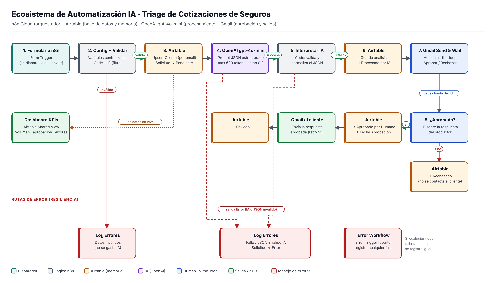
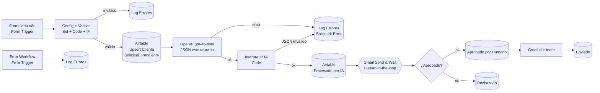

# Entrega Final Coderhouse · Ecosistema de Automatización IA Autónomo

**Martin Di Filippo** · Curso IA Automation · Coderhouse

> **Caso de uso:** triage automático de pedidos de cotización para un productor asesor de seguros generales.
> Un cliente pide una cotización; la IA interpreta el pedido, extrae los datos, detecta lo que falta, asigna una prioridad y redacta la respuesta. El productor aprueba o rechaza con un clic y recién ahí se contacta al cliente.

---

## 🔗 Enlaces de la entrega

| Recurso | Enlace |
|---|---|
| 🎥 Video demo (≤ 3 min) | **[COMPLETAR: link de Loom / YouTube no listado]** |
| 📊 Dashboard de control (KPIs) | **[COMPLETAR: link público de la Shared View / Interface de Airtable]** |
| 🗄️ Base de datos (solo lectura) | **[COMPLETAR: link público de la Shared View de Airtable]** |
| ⚙️ Flujo principal (JSON / Blueprint) | [`workflow/cotizaciones-flujo-principal.json`](workflow/cotizaciones-flujo-principal.json) |
| 🛟 Workflow de manejo de errores (JSON) | [`workflow/cotizaciones-manejo-errores.json`](workflow/cotizaciones-manejo-errores.json) |
| 🧾 Esquemas JSON de integración | [`docs/schemas/`](docs/schemas/) |
| 🖼️ Capturas de evidencia | [`docs/img/`](docs/img/) |

---

## Índice

1. [Problema y propuesta](#1-problema-y-propuesta)
2. [Stack tecnológico](#2-stack-tecnológico-4-categorías-obligatorias)
3. [Diagrama de arquitectura](#3-diagrama-de-arquitectura)
4. [Cómo funciona el flujo](#4-cómo-funciona-el-flujo-paso-a-paso)
5. [Base de datos: tablas vinculadas](#5-base-de-datos-el-cerebro)
6. [Esquemas JSON de las integraciones](#6-esquemas-json-de-las-integraciones)
7. [Prompt y control del LLM](#7-prompt-y-control-del-llm)
8. [Matriz de costos y optimización](#8-matriz-de-costos-y-optimización)
9. [Seguridad y resiliencia](#9-seguridad-y-resiliencia)
10. [Pruebas de estrés (5 ejecuciones)](#10-pruebas-de-estrés-5-ejecuciones)
11. [Dashboard de control](#11-dashboard-de-control)
12. [Manual operativo](#12-manual-operativo)
13. [Mejoras futuras](#13-mejoras-futuras)

---

## 1. Problema y propuesta

**Situación actual (manual):** el productor recibe pedidos de cotización por distintos canales, con texto libre y casi siempre incompletos. Por cada pedido tiene que leerlo, identificar el tipo de seguro, ver qué datos faltan, decidir a quién responder primero y escribir un mail. Los pedidos urgentes (pólizas por vencer, clientes que vienen de otra compañía) se mezclan con consultas generales.

**Propuesta:** un sistema que procesa cada pedido de punta a punta sin intervención manual, salvo un único punto de control humano antes de contactar al cliente:

- ✅ Registra cliente y solicitud en una base de datos con estados.
- ✅ La IA interpreta el lenguaje natural y devuelve datos estructurados (JSON).
- ✅ Prioriza automáticamente (Alta / Media / Baja) con un motivo explicado.
- ✅ Redacta la respuesta pidiendo exactamente los datos que faltan.
- ✅ **Human-in-the-loop:** el productor aprueba o rechaza desde su Gmail.
- ✅ Todo error queda registrado y la solicitud nunca queda "perdida".

---

## 2. Stack tecnológico (4 categorías obligatorias)

| Categoría | Herramienta | Uso en el sistema |
|---|---|---|
| **Orquestador** | n8n Cloud | Flujo principal (18 nodos) + workflow de errores separado |
| **Base de datos** | Airtable | Memoria y registro: `Clientes`, `Solicitudes`, `Log Errores` (vinculadas) |
| **Procesamiento IA** | OpenAI `gpt-4o-mini` (nodo nativo de n8n) | Clasificación, extracción de datos, priorización y redacción, con salida JSON estructurada |
| **Canal de salida** | Gmail | Aprobación humana (*Send and Wait*) y respuesta al cliente |

---

## 3. Diagrama de arquitectura



<details>
<summary>Versión en texto (Mermaid)</summary>


</details>


---

## 4. Cómo funciona el flujo (paso a paso)

| # | Nodo | Tipo | Qué hace |
|---|---|---|---|
| 1 | **Formulario de cotización** | Form Trigger | Trigger inteligente: el flujo solo corre cuando un cliente envía el formulario (no hay polling ni consumo innecesario). |
| 2 | **Config** | Set | Centraliza todas las variables: base de Airtable, nombres de tablas, modelo, `maxTokens`, nombre y email del productor y el prompt. **Ningún otro nodo tiene datos hardcodeados.** |
| 3 | **Validar y normalizar** | Code | Limpia espacios, pasa el email a minúsculas y valida: nombre presente, email con formato válido y mensaje de al menos 15 caracteres. |
| 4 | **¿Datos válidos?** | IF | Filtro: si los datos no sirven, se registra en `Log Errores` y **no se llama a la IA** (ahorro de tokens). |
| 5 | **Crear o actualizar cliente** | HTTP → Airtable | *Upsert* por email: no se duplican clientes. |
| 6 | **Crear solicitud** | HTTP → Airtable | Crea la solicitud vinculada al cliente con `Estado = Pendiente`. |
| 7 | **Analizar con IA** | OpenAI (nativo) | `gpt-4o-mini`, temperatura 0.2, máx. 600 tokens. Devuelve el JSON definido en el prompt. Reintenta 3 veces y tiene salida de error. |
| 8 | **Interpretar respuesta IA** | Code | Valida que la respuesta sea un JSON correcto, normaliza los valores a las listas permitidas y cuenta los tokens. Si falla, sale por la rama de error. |
| 9 | **Guardar análisis IA** | HTTP → Airtable | Guarda tipo, datos extraídos, faltantes, prioridad, respuesta y tokens → `Procesado por IA`. |
| 10 | **Pedir aprobación (HITL)** | Gmail *Send and Wait* | Envía al productor un resumen con botones **Aprobar y enviar / Rechazar**. **La ejecución queda en pausa** hasta la decisión. |
| 11 | **¿Aprobado?** | IF | Bifurca según la decisión humana. |
| 12a | **Marcar aprobado → Enviar respuesta al cliente → Marcar enviado** | Airtable + Gmail | `Aprobado por Humano` (con fecha) → mail al cliente → `Enviado`. |
| 12b | **Marcar rechazado** | HTTP → Airtable | `Rechazado` (con fecha). No se contacta al cliente. |
| E1 | **Registrar error de validación** | HTTP → Airtable | Datos inválidos → `Log Errores`. |
| E2 | **Registrar error IA → Marcar solicitud con error** | HTTP → Airtable | Falla de la API o JSON inválido → `Log Errores` (vinculado a la solicitud) + `Estado = Error`. |
| E3 | **Workflow "Manejo de errores"** | Error Trigger | Configurado como *Error Workflow* del principal: cualquier falla no contemplada también queda registrada. |

---

## 5. Base de datos (el "cerebro")

Base de Airtable **Cotizaciones**, con tres tablas vinculadas entre sí para evitar datos aislados:

```
Clientes (1) ──< (N) Solicitudes (1) ──< (N) Log Errores
```


### Tabla `Clientes`
| Campo | Tipo | Nota |
|---|---|---|
| Nombre | Texto (principal) | |
| Email | Email | Clave del *upsert* (evita duplicados) |
| Telefono | Teléfono | |
| Solicitudes | Link → Solicitudes | Historial del cliente |

### Tabla `Solicitudes`
| Campo | Tipo | Nota |
|---|---|---|
| Id | Autonumber (principal) | |
| Fecha | Created time | |
| Cliente | Link → Clientes | |
| Mensaje Original | Texto largo | Texto libre del cliente |
| Tipo de Seguro | Selección: Auto, Hogar, Comercio, Vida, Otro | Lo define la IA |
| Datos Extraidos | Texto largo (JSON) | Lo que el cliente informó |
| Datos Faltantes | Texto largo | Lo que falta para cotizar |
| Prioridad | Selección: Alta, Media, Baja | |
| Motivo Prioridad | Texto largo | Explicación de la IA (trazabilidad) |
| Respuesta Sugerida | Texto largo | Borrador para el cliente |
| **Estado** | Selección: **Pendiente → Procesado por IA → Aprobado por Humano → Enviado** · Rechazado · Error | Ciclo de vida de la solicitud |
| Tokens usados | Número | Control de costos |
| Fecha Aprobacion | Fecha y hora | Momento de la decisión humana |
| Log Errores | Link → Log Errores | |


### Tabla `Log Errores`
| Campo | Tipo | Nota |
|---|---|---|
| Error ID | Fórmula (principal) | `"ERR-" & DATETIME_FORMAT(SET_TIMEZONE(Fecha,'America/Argentina/Buenos_Aires'),'YYYYMMDD-HHmm') & " · " & Nodo` |
| Fecha | Created time | |
| Workflow | Texto | |
| Nodo | Texto | Nodo que falló |
| Mensaje de Error | Texto largo | |
| Execution ID | Texto | Para buscar la ejecución en n8n |
| Solicitud | Link → Solicitudes | Solicitud afectada (cuando aplica) |


**Sincronización:** el único que escribe en la base es el flujo de n8n (vía API REST de Airtable con *Personal Access Token*). El estado de cada solicitud avanza en un solo sentido, siempre desde el flujo.

---

## 6. Esquemas JSON de las integraciones

Todos los contratos de datos están en [`docs/schemas/`](docs/schemas/):

| Archivo | Integración | Dirección |
|---|---|---|
| [`01-entrada-formulario.json`](docs/schemas/01-entrada-formulario.json) | Form Trigger → n8n | Entrada del sistema |
| [`02-validacion.json`](docs/schemas/02-validacion.json) | Salida del nodo de validación | Interno |
| [`03-salida-ia.schema.json`](docs/schemas/03-salida-ia.schema.json) | **Contrato del LLM** (JSON Schema) | OpenAI → n8n |
| [`04-interpretar-ia.json`](docs/schemas/04-interpretar-ia.json) | Respuesta de la IA normalizada | Interno |
| [`05-airtable-solicitud.json`](docs/schemas/05-airtable-solicitud.json) | Crear / actualizar solicitud en cada estado | n8n → Airtable |
| [`06-airtable-cliente-upsert.json`](docs/schemas/06-airtable-cliente-upsert.json) | Upsert de cliente | n8n → Airtable |
| [`07-gmail-aprobacion.json`](docs/schemas/07-gmail-aprobacion.json) | Respuesta de la aprobación humana | Gmail → n8n |
| [`08-log-error.json`](docs/schemas/08-log-error.json) | Registro de errores | n8n → Airtable |

**Contrato de salida del LLM** (resumen):

```json
{
  "tipo_seguro": "Auto | Hogar | Comercio | Vida | Otro",
  "datos_extraidos": { "marca": "Toyota", "modelo": "Corolla", "anio": "2020", "codigo_postal": "1704" },
  "datos_faltantes": ["..."],
  "prioridad": "Alta | Media | Baja",
  "motivo_prioridad": "string",
  "respuesta_sugerida": "string (≤ 120 palabras, sin precios)"
}
```

---

## 7. Prompt y control del LLM

El prompt es **dinámico**: vive en el nodo `Config` y se arma en tiempo de ejecución (`[PRODUCTOR]` se reemplaza por el nombre del productor; el mensaje del usuario se arma con el nombre y el texto del cliente).

<details>
<summary>Ver prompt de sistema completo</summary>

```text
Sos el asistente de [PRODUCTOR], productor asesor de seguros en Argentina. Analizás pedidos de cotización
escritos por clientes y respondés ÚNICAMENTE con un objeto JSON válido, sin texto extra, con estas claves:
- tipo_seguro: uno de Auto, Hogar, Comercio, Vida, Otro.
- datos_extraidos: objeto con los datos que el cliente SÍ dio (...). No inventes datos.
- datos_faltantes: lista de textos con los datos mínimos que faltan para poder cotizar.
- prioridad: Alta, Media o Baja.
- motivo_prioridad: una oración que explique por qué esa prioridad.
- respuesta_sugerida: el cuerpo de un email para el cliente.

Datos mínimos para cotizar:
- Auto: marca, modelo, año, código postal, uso (particular o comercial) y cobertura deseada.
- Hogar: tipo de vivienda, metros cuadrados, código postal y si quiere cubrir el contenido.
- Comercio: rubro, metros cuadrados, código postal y actividad principal.
- Vida: edad, ocupación y suma asegurada buscada.

Criterios de prioridad:
- Alta: quiere contratar pronto, su póliza vence en menos de 30 días, viene de otra compañía o asegura varios bienes.
- Media: pedido concreto sin urgencia declarada.
- Baja: consulta general o pedido muy incompleto.

Reglas para respuesta_sugerida: español rioplatense, tono cordial y profesional, máximo 120 palabras,
saludar al cliente por su nombre, si faltan datos pedirlos en una lista breve, NO dar precios ni prometer
coberturas, firmar como "El equipo de [PRODUCTOR]".
Si el mensaje no es un pedido de seguro, usá tipo_seguro Otro, prioridad Baja y respondé pidiendo más información.
```
</details>

**Controles aplicados sobre el modelo:**
- `temperature = 0.2` → respuestas consistentes y repetibles.
- `max tokens = 600` → techo de costo por ejecución.
- Salida **solo JSON** + validación en código → si el modelo "se va de tema", el flujo no lo envía.
- Reglas de negocio en el prompt: **no inventar datos, no dar precios, no prometer coberturas.**


---

## 8. Matriz de costos y optimización

### 8.1 Costo real medido

| Métrica | Valor |
|---|---|
| Tokens por solicitud (medido en Airtable, campo `Tokens usados`) | **≈ 675** (≈ 520 entrada + 155 salida) |
| Precio `gpt-4o-mini`* | USD 0,15 / 1M tokens de entrada · USD 0,60 / 1M de salida |
| **Costo por solicitud** | **≈ USD 0,00017** |
| Costo por 1.000 solicitudes | **≈ USD 0,17** |
| Costo de un pedido inválido (validación) | **USD 0** (no llega a la IA) |

\* Precios de referencia de la lista pública de OpenAI; verificar en [openai.com/api/pricing](https://openai.com/api/pricing) a la fecha. Durante el desarrollo se usaron los créditos incluidos de n8n Cloud.

### 8.2 Matriz de decisión: qué modelo para qué tarea

| Tarea | Modelo recomendado | Por qué | Costo relativo |
|---|---|---|---|
| **Clasificar, extraer datos y redactar respuestas cortas** (este flujo) | **`gpt-4o-mini`** ✅ | Tarea simple y estructurada; calidad suficiente, rápido y barato. | 1× |
| Leer documentos densos: pólizas en PDF, condiciones generales, denuncias de siniestro largas | Claude (Sonnet) o `gpt-4o` | Mejor comprensión de textos largos y matices legales. | ~15–20× |
| Procesos masivos sin urgencia: re-clasificar todo el historial de clientes, campañas de renovación nocturnas | `gpt-4o-mini` vía **Batch API** | Mismo modelo con ~50 % de descuento; los resultados llegan en horas, sin impacto porque no hay cliente esperando. | ~0,5× |
| Casos sensibles: reclamos, siniestros con lesionados | Modelo grande **+ revisión humana obligatoria** | El costo del error supera al costo del modelo. | — |

**Comparación directa para este flujo (1.000 solicitudes/mes):**

| Modelo | Costo estimado | Diferencia |
|---|---|---|
| `gpt-4o-mini` | ≈ USD 0,17 | — |
| `gpt-4o` (USD 2,50 / 10 por 1M) | ≈ USD 2,85 | **~17× más caro, sin mejora relevante para clasificar** |

### 8.3 Optimizaciones aplicadas
1. **Filtro previo a la IA:** los pedidos inválidos se descartan antes de llamar al modelo (costo 0).
2. **Trigger por evento** (formulario) en lugar de polling → cero ejecuciones vacías.
3. **Límite de tokens** (600) y **temperatura baja** → costo acotado y predecible.
4. **Prompt compacto y salida JSON** → menos tokens de salida y nada de texto de relleno.
5. **Tokens registrados por solicitud** → el costo se audita desde la base de datos.

### 8.4 Ahorro operativo estimado
| | Manual | Con el sistema |
|---|---|---|
| Tiempo por pedido (leer, clasificar, redactar) | ~10 min | ~1 min (revisar y aprobar) |
| 100 pedidos / mes | ~16,5 h | ~1,7 h |
| **Ahorro** | | **~15 h/mes por un costo de IA < USD 0,02** |

---

## 9. Seguridad y resiliencia

### 9.1 Human-in-the-loop (evitar el "efecto metralleta")
- El sistema **nunca contacta al cliente sin aprobación**. El nodo *Gmail Send and Wait* pausa la ejecución (estado `Waiting` en n8n) hasta que el productor decide.
- El mail de aprobación muestra el mensaje original, el tipo, la prioridad con su motivo, los datos faltantes y la respuesta propuesta.
- **Aprobar** → `Aprobado por Humano` (+ fecha) → envío → `Enviado`.
- **Rechazar** → `Rechazado` (+ fecha) → no se envía nada.


### 9.2 Manejo de errores (3 capas)

| Capa | Qué cubre | Qué hace |
|---|---|---|
| **1. Validación de entrada** (Code + IF) | Mensajes vacíos o demasiado cortos, email inválido | Registra en `Log Errores` y termina, **sin consumir IA** |
| **2. Salida de error de los nodos de IA** (`On Error → Continue using error output`) | Falla de la API (timeout, cuota, credencial) o respuesta que no es un JSON válido | Registra en `Log Errores` vinculado a la solicitud y la pasa a `Estado = Error` |
| **3. Error Workflow** (workflow separado con *Error Trigger*) | Cualquier falla no contemplada en el flujo principal | Registra workflow, nodo, mensaje y Execution ID en `Log Errores` |

Además:
- **Reintentos automáticos** (*Retry On Fail*, 3 intentos, 2 s de espera) en las llamadas a Airtable, OpenAI y Gmail → cubren fallas transitorias de red o de las APIs.
- **Validación de la respuesta del LLM:** los valores fuera de las listas permitidas se normalizan (por ejemplo, un tipo de seguro desconocido pasa a `Otro`).
- **Ninguna solicitud se pierde:** siempre queda en un estado final (`Enviado`, `Rechazado` o `Error`).


### 9.3 Seguridad de credenciales y datos
- Las API keys (Airtable, OpenAI, Gmail OAuth2) se guardan en el **gestor de credenciales de n8n**. **No aparecen en los JSON exportados, en este repositorio ni en el video.**
- El token de Airtable tiene **permisos mínimos**: solo `data.records:read`, `data.records:write` y `schema.bases:read`, y solo sobre la base *Cotizaciones*.
- Los enlaces públicos (dashboard y base) son **de solo lectura**.

### 9.4 Check de seguridad antes de enviar

| Pregunta | Respuesta |
|---|---|
| ¿El flujo tiene un filtro para evitar bucles infinitos? | ✅ Sí. El trigger es un formulario (un envío = una ejecución). El flujo no escribe nada que lo vuelva a disparar, el IF de validación corta los datos inválidos y el Error Workflow es un workflow aparte que no puede reactivar el principal. |
| ¿Se comparan tipos de datos correctos en los filtros? | ✅ Sí. `¿Datos válidos?` compara un **booleano** (`valido`) con validación estricta, y `¿Aprobado?` evalúa el booleano `data.approved`. `Tokens usados` se guarda como **número**. |
| ¿El prompt de IA es dinámico y usa variables del sistema? | ✅ Sí. El prompt sale del nodo `Config` (`promptSistema`, `nombreProductor`) y el mensaje del usuario se arma con `nombre` y `mensaje` del cliente en cada ejecución. |

---

## 10. Pruebas de estrés (5 ejecuciones)

| # | Escenario | Entrada | Resultado esperado | Resultado obtenido |
|---|---|---|---|---|
| 1 | ✅ **Camino feliz** | *"Quiero pasarme de compañía. Toyota Corolla 2020, uso particular, CP 1704, todo riesgo. Mi póliza vence la semana que viene."* | Auto · prioridad Alta → aprobado → `Enviado` | ✅ Correcto: mail recibido por el cliente |
| 2 | 🙅 **Rechazo humano** | *"Hola, quiero asegurar mi departamento en Ramos Mejía. ¿Me pueden pasar una cotización?"* | Hogar · faltan datos → rechazado → `Rechazado`, sin mail al cliente | ✅ Correcto: Hogar · Baja · faltantes: tipo de vivienda, m², contenido |
| 3 | 💬 **Consulta que no es pedido** | *"Quería saber el horario de atención de la oficina"* | Tipo `Otro` · prioridad Baja | ✅ **[COMPLETAR con lo que dio]** |
| 4 | ❌ **Camino infeliz: datos inválidos** | Mensaje: *"hola"* | Corta en la validación → `Log Errores`, **sin llamar a la IA** | ✅ Correcto (ejecución #117) |
| 5 | ❌ **Camino infeliz: respuesta inválida del LLM** | Pedido normal con `max tokens = 5` (simula una respuesta truncada o malformada) | `Interpretar IA` falla → `Log Errores` + `Estado = Error`, sin contactar al cliente | ✅ Correcto |


<details>
<summary>Ver evidencias de cada prueba</summary>

**Prueba 1 · Camino feliz**


**Prueba 2 · Rechazo humano**


**Prueba 3 · Consulta general**


**Prueba 4 · Datos inválidos**


**Prueba 5 · Error de IA**


**Formulario de entrada**

</details>

**Hallazgo de calidad:** en la prueba 2 la IA escribió "¿Quieres…?" (tuteo) aunque el prompt pide voseo rioplatense. No afecta al funcionamiento, y el Human-in-the-loop permite corregirlo antes del envío. Queda como mejora futura reforzar ese punto en el prompt.

---

## 11. Dashboard de control

**🔗 [COMPLETAR: link público del dashboard]**

| KPI | Cómo se calcula | Para qué sirve |
|---|---|---|
| **Volumen de solicitudes** | Cantidad de registros en `Solicitudes` (total y por tipo de seguro) | Carga de trabajo |
| **Tasa de aprobación** | `Aprobado por Humano` + `Enviado` ÷ (aprobadas + `Rechazado`) | Qué tan buenas son las respuestas de la IA |
| **Tasa de error** | Solicitudes en `Error` ÷ total (+ registros en `Log Errores`) | Salud técnica del sistema |
| Prioridad Alta pendiente | Solicitudes `Alta` que todavía no están `Enviado` | Qué atender primero |
| Tokens consumidos | Suma de `Tokens usados` | Control de costo |


---

## 12. Manual operativo

### 12.1 Puesta en marcha (desde cero)
1. **Airtable:** crear la base con las 3 tablas de la [sección 5](#5-base-de-datos-el-cerebro). Los nombres de campos deben coincidir **exactamente**, sin espacios extra.
2. **Token de Airtable:** `airtable.com/create/tokens` → scopes `data.records:read`, `data.records:write` y `schema.bases:read` → acceso solo a la base.
3. **n8n:** importar `workflow/cotizaciones-manejo-errores.json` (*Import from File*), asignar la credencial de Airtable y **publicarlo**. Si no está publicado, no aparece como opción de Error Workflow.
4. Importar `workflow/cotizaciones-flujo-principal.json` y asignar las credenciales: Airtable (nodos HTTP), OpenAI (nodo *Analizar con IA*) y Gmail OAuth2 (los dos nodos de Gmail).
5. Completar el nodo **Config**: `baseId` (copiarlo de la URL de Airtable, la parte que empieza con `app`), `nombreProductor` y `emailProductor`.
6. En el flujo principal: **⋯ → Settings → Error Workflow** → elegir el workflow de errores.
7. **Publicar** el flujo principal y compartir con los clientes la **Production URL** del formulario.

### 12.2 Operación diaria (productor)
1. Llega un mail **"[Prioridad] Aprobar respuesta a {cliente} – {tipo}"**.
2. Leer el mensaje original, los datos faltantes y la respuesta sugerida.
3. **Aprobar y enviar** si la respuesta es correcta, o **Rechazar** para contestar por otro medio (por ejemplo, llamar al cliente).
4. Revisar el dashboard para ver lo pendiente, sobre todo la prioridad Alta.

### 12.3 Cambios frecuentes (sin tocar la lógica)
| Quiero… | Dónde |
|---|---|
| Cambiar el modelo de IA | `Config → modeloIA` |
| Cambiar el límite de tokens | `Config → maxTokens` / opciones del nodo de IA |
| Ajustar criterios de prioridad, datos mínimos o tono | `Config → promptSistema` |
| Cambiar quién aprueba | `Config → emailProductor` |

### 12.4 Solución de problemas
| Síntoma | Causa probable | Solución |
|---|---|---|
| `Forbidden – perhaps check your credentials` (Airtable 403) | `baseId` mal copiado o token sin acceso a la base | Copiar el ID desde la URL; revisar *Access* del token |
| `Unknown field name: "X"` (Airtable 422) | El nombre del campo no coincide (espacio extra, tilde) | Reescribir el nombre del campo en Airtable |
| No se puede escribir en un campo | El campo es calculado (fórmula / IA de Airtable) | Cambiarlo a *Long text* |
| `Credentials not found` en la IA | Falta asignar la credencial de OpenAI | Elegir la credencial en el nodo |
| Ejecución en `Waiting` | Está esperando la aprobación humana | Responder el mail de aprobación |
| Solicitud en `Error` | Ver `Log Errores` → `Execution ID` | Abrir esa ejecución en n8n → *Executions* |

---

## 13. Mejoras futuras
- Reforzar el voseo en el prompt (hallazgo de la prueba 2).
- Recibir pedidos también por **WhatsApp** (plantilla aprobada, formato internacional `+54…`) y por mail entrante.
- Recordatorio automático si una aprobación lleva más de 24 h pendiente.
- Integración con el cotizador de las compañías para adjuntar precios a la respuesta.
- Usar la **Batch API** para campañas de renovación masivas.

---

*Proyecto académico · Coderhouse · 2026*
